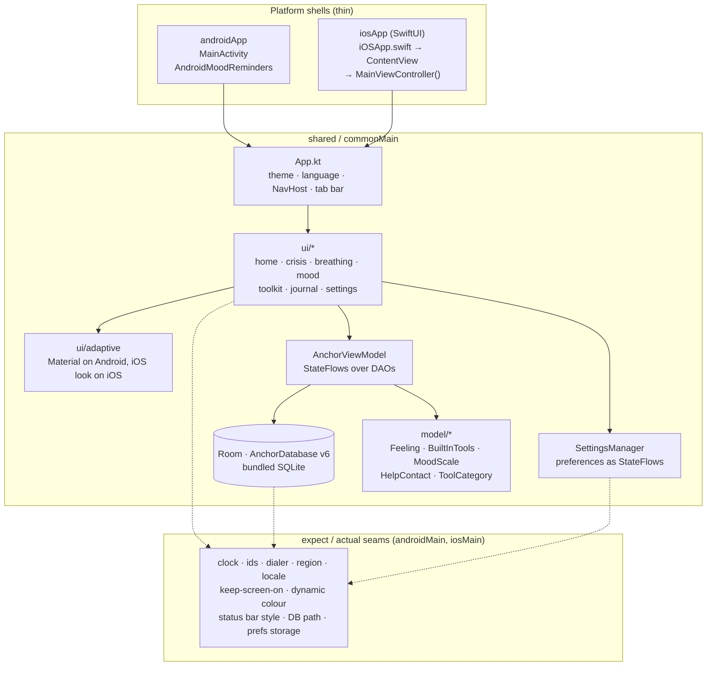

# Anchor

**A coping companion for people in therapy — Android and iOS, fully offline.**

Anchor is built around one question: *what do you reach for when things get bad, at the moment
you are least able to think clearly?* The useful thing is not advice. It is **your own** coping
strategies, written down while you are calm and arranged so you can reach them one-handed on a
bad day.

> **Working on the code, or an AI agent?** Start with [`AGENTS.md`](AGENTS.md): the
> architecture as concrete rules (where code goes, what never to do, how to verify).

---

## Contents

1. [The problem and the requirements](#the-problem-and-the-requirements)
2. [What the app does](#what-the-app-does)
3. [Architecture at a glance](#architecture-at-a-glance)
4. [Architectural decisions](#architectural-decisions)
5. [Code map](#code-map)
6. [Build, run, test](#build-run-test)
7. [Toolchain constraints](#toolchain-constraints)
8. [Known limitations](#known-limitations)
9. [A note on scope](#a-note-on-scope)

---

## The problem and the requirements

People in therapy build up coping strategies between sessions — a breathing pattern that works,
a friend to text, a walk around the block. In a crisis those strategies are exactly what is hard
to remember. Generic wellness apps offer *their* advice; Anchor stores *yours*.

The requirements we designed against, and where each one is met:

| # | Requirement | How Anchor meets it |
|---|-------------|---------------------|
| R1 | **Reachable in one tap on a bad day.** No menus, no reading. | A single SOS button on an intentionally empty Home starts the crisis flow. A *Call for help* button is pinned under every step of it. |
| R2 | **Route by what is actually happening.** Telling an angry person to breathe makes it worse. | The flow asks for a feeling first. Sad / Angry / Exhausted skip breathing; each feeling maps to tool categories (`model/Feeling.kt`). |
| R3 | **The user's own strategies come first.** | Suggestions are drawn from the user's toolkit; built-in techniques fill in only when it is thin, and can be saved with one tap. |
| R4 | **Never leave someone alone when it did not help.** | The check-in after the flow is stored immediately. A low rating offers another round, the user's trusted contact, and a crisis line for their region. It never congratulates someone who still feels bad. |
| R5 | **Support the therapy itself.** | A journal with tags and a "bring up next session" flag, plus a list of questions for the therapist. A mood tracker with history shows trends between sessions. |
| R6 | **Private by construction.** This is mental-health data. | No account, no server, no analytics. The Android app does not even request the `INTERNET` permission. Cloud backup excludes the database. |
| R7 | **Both platforms, native feel, one small team.** | Kotlin Multiplatform + Compose Multiplatform: one codebase, Material 3 on Android and an iOS-styled UI on iOS. |
| R8 | **Works in Switzerland's languages.** | English, German, French and Italian, switchable in Settings. Default crisis line follows the device region (12 countries), falling back to Switzerland's **143**. |
| R9 | **Never lose the journal.** | Real Room migrations for every schema version, no destructive fallback: a missing migration fails loudly instead of wiping data. |

## What the app does

| Area | What you get |
|------|--------------|
| **Home** | Greeting, stats (tools / sessions / notes), last crisis session, the breathing and mood-tracker cards, and the SOS button. Mostly empty on purpose. |
| **Crisis flow** | `Feeling` → `Breathing` (skipped where it would not help) → `Suggested tools` → `Check-in`. Full screen, no tab bar, survives rotation. One-tap dialling of the crisis line or a trusted person from every step. |
| **Breathing practice** | Several patterns (`BreathingPattern`), haptics on each phase, screen kept awake. |
| **Mood tracker** | 1–5 check-ins at any time, history over 6 h / today / 7 / 30 days. Optional reminders in a daily time window, on both Android and iOS, answerable straight from the notification. Crisis check-ins land in the same timeline. |
| **Toolkit** | Your coping tools, with a category, add / edit / delete, and an empty state that points to the built-in suggestions. |
| **Journal** | Therapy notes with tags and a "bring up next session" flag, a full-screen editor, and a Questions tab. |
| **Settings** | Name, appearance (system / light / dark, optional Material You wallpaper colours on Android), language, crisis breathing pattern, own crisis line and trusted contact, mood reminders. |

---

## Architecture at a glance

Anchor is a **Kotlin Multiplatform** app. Practically everything — models, database, state, and the
entire **Compose Multiplatform** UI — lives in one shared module. The two platform apps are thin
shells that create the database and settings once and hand them to the shared `App` composable.



### Layers

There are deliberately only three, and no DI framework or repository layer — the app is small
enough that each extra layer would be ceremony.

1. **UI** (`ui/`) — stateless-ish Compose screens. Each takes the ViewModel and/or
   `SettingsManager` as a plain parameter and collects `StateFlow`s with `collectAsState`.
2. **State** — one `AnchorViewModel` (database-backed data) and one `SettingsManager`
   (preferences, on top of `multiplatform-settings`). Writes are fire-and-forget coroutines in
   `viewModelScope`; reads are Room `Flow`s exposed as `StateFlow`s.
3. **Data** (`data/`, `model/`) — Room entities and DAOs, migrations, and pure Kotlin domain
   logic (feeling routing, built-in tools, mood scale, reminder schedule, tags) that is unit
   tested without a device.

### Navigation

A single `NavHost` in `App.kt` (JetBrains' multiplatform port of navigation-compose).

| Route | Kind | Tab bar |
|-------|------|---------|
| `home`, `toolkit`, `journal`, `settings` | Tabs (`AnchorTab` enum owns routes, icons, labels) | Visible |
| `mood` | Page under Home; Home stays selected and acts as Back | Visible |
| `crisis`, `breathing`, `note?id=` | Full-screen destinations; slide up like a modal on iOS | Hidden |

The crisis flow is a destination rather than an overlay boolean, so system back leaves it,
the tab bar cannot be tapped through it, and its step state (`rememberSaveable`) survives
rotation. Close actions use `dropUnlessResumed` so a double tap during the exit animation
cannot pop Home too.

### Data model

Room, schema **version 6**, five tables:

| Entity | Purpose |
|--------|---------|
| `CopingTool` | A user's tool: name, category **key**, description |
| `TherapyNote` | Journal note: body, `tags: List<String>`, `flaggedForNextSession`, timestamp |
| `SessionQuestion` | A question for the next session, with a done state |
| `CrisisCheckIn` | Feeling + how the user felt afterwards, per completed rating |
| `MoodEntry` | Score 1–5 (5 = great), source (app / notification / crisis / sample), unique `promptId` so a notification answer is stored once |

Every version has an exported schema in `shared/schemas/` and an explicit migration in
`data/Migrations.kt` / `data/MoodMigrations.kt`.

### Platform seams

Only what has no common API differs per platform, as `expect`/`actual` in
`shared/src/{androidMain,iosMain}`:

| Seam | File |
|------|------|
| Clock and random ids | `platform/Platform.kt` |
| `isIosHost` (read through `LocalIsIos`) | `platform/Platform.kt` |
| Phone dialer | `platform/Dialer.kt` |
| Device region → default crisis line | `platform/Region.kt` |
| In-app language override | `platform/AppLocale.kt` |
| Keep the screen on while breathing | `platform/KeepScreenOn.kt` |
| Material You colours, status-bar / interface style | `ui/theme/Theme.kt` |
| Room constructor | `data/AnchorDatabase.kt` (generated by Room's KSP) |
| Database file and preference storage | `data/DatabaseFactory.*.kt`, `settings/SettingsFactory.*.kt` |
| Mood reminders | `MoodReminderController` interface; `AndroidMoodReminders.kt` (AlarmManager) and `IosMoodReminders.kt` (UNUserNotificationCenter) |

### One UI, two native looks

The same screens render as Material 3 on Android and as an iOS-styled UI on iOS, decided at
runtime through the `LocalIsIos` composition local:

- **`AnchorTheme`** fills the same `MaterialTheme` slots with either Anchor's calm palette
  (sage / lavender / peach) or iOS system-style colours, SF-like typography, iOS radii, and a
  grey press highlight instead of ripples. Screens keep reading `MaterialTheme.colorScheme`.
- **`ui/adaptive/`** has one wrapper per control — `AnchorButton`, `AdaptivePageScaffold`
  (large collapsing title on iOS), `AdaptiveTabBar` (floating capsule on iOS), `AdaptiveSheet`,
  `AdaptiveSwitch`, `AdaptiveSegmentedControl`, `adaptiveSection` (inset-grouped lists),
  `SwipeToDelete` and more. Screens use these, never raw Material controls.
- Interaction differs where the platforms differ: on iOS rows open on tap and delete by swipe,
  modals slide up, tab switches are instant; on Android rows have explicit edit/delete icons and
  tabs cross-fade.

---

## Architectural decisions

The decisions that shape the codebase, and why. Each one was a trade-off; the "cost" column is
what we accepted.

| # | Decision | Why | Cost we accepted |
|---|----------|-----|------------------|
| D1 | **Kotlin Multiplatform with Compose Multiplatform for the whole UI**, not native UI per platform | A small team in a hackathon ships both platforms from one codebase; the crisis flow must behave identically on both. | iOS look is emulated (see D3), and a very tightly pinned toolchain (see below). |
| D2 | **One shared module, thin platform shells** | Keeps all logic and UI in `commonMain`; platform code is only what has no common API. AGP 9 forbids an application module that is also KMP, hence `shared` (KMP library) + `androidApp` (shell). | Two Android modules instead of one. |
| D3 | **Runtime platform switch (`LocalIsIos`) + adaptive wrappers**, not `expect`/`actual` per screen | One screen file per feature; previews can force either look; changes land on both platforms at once. | Wrappers must be used consistently — a raw Material control looks wrong on iOS. |
| D4 | **Single `AnchorViewModel`, no DI, no repository layer** | Five tables and one user; extra layers would add indirection without value. One instance is created at each entry point and passed down explicitly (no `= viewModel()` defaults), so there is never a second copy. | The ViewModel will need splitting if the app grows much further. |
| D5 | **Room with bundled SQLite** | Same database code and same SQLite version on Android and iOS; compile-time checked queries; exported schemas. | Room in KMP needs KSP per target and an `expect object` constructor. |
| D6 | **Real migrations, no destructive fallback** | A therapy journal must never be silently wiped by an update. A missing migration now crashes in development instead of deleting user data in production. | Every schema change needs a hand-written migration. |
| D7 | **Fully offline, no account** | Mental-health data is the most sensitive data there is. Nothing to breach if nothing leaves the phone. No `INTERNET` permission at all. | No sync between devices. Android device-to-device transfer keeps the journal; cloud backup deliberately excludes it. |
| D8 | **Store stable keys, render translated labels** | Tool categories are stored as `ToolCategory.key`; the crisis router matches feelings to keys. Storing translated text would break matching as soon as the language changes. | Labels are resolved at render time everywhere. |
| D9 | **All copy in Compose Resources (EN / DE / FR / IT)** | Swiss context; and the crisis copy is deliberate (it does not congratulate someone who still feels bad), so it must be reviewable in one place. | Compose Resources' rules differ from Android's (positional `%1$d`, no `\'` escape). |
| D10 | **Crisis line by device region, overridable** | The most important number in the app has to be right without setup. 12 built-in countries, Switzerland's 143 as fallback, any number can be set in Settings, plus a trusted person. | The built-in list must be maintained. |
| D11 | **Crisis flow and editor as navigation destinations** | System back, rotation and tab-bar behaviour come out right by construction rather than by special cases. | Slightly more navigation code in `App.kt`. |
| D12 | **Vendored Material icons** (`ui/icons/AnchorIcons.kt`) | `material-icons` has no multiplatform build at the Compose version we need. | New icons are added as path data by hand. |

---

## Code map

```
shared/src/
├── commonMain/kotlin/ch/bfh/anchor/
│   ├── App.kt                 entry composable: theme, language, NavHost, tab bar
│   ├── model/                 domain: Feeling, BuiltInTools, ToolCategory, MoodEntry/MoodScale,
│   │                          MoodReminderSchedule, BreathingPattern, HelpContact, Tags, …
│   ├── data/                  Room database, DAOs, migrations, TagListConverter
│   ├── viewmodel/             AnchorViewModel
│   ├── settings/              SettingsManager (preferences as StateFlows)
│   ├── notifications/         MoodReminderController interface
│   ├── platform/              expect declarations + date formatting
│   └── ui/
│       ├── adaptive/          Material-or-iOS control wrappers
│       ├── theme/             palette, Material + iOS colour schemes, typography
│       ├── components/        shared calm-look pieces
│       ├── home/ crisis/ breathing/ mood/ toolkit/ journal/ settings/
│       └── icons/             vendored Material icon paths
├── commonMain/composeResources/values{,-de,-fr,-it}/strings.xml
├── commonTest/                unit tests for the pure logic
├── androidMain/               actuals for Android
└── iosMain/                   actuals for iOS, MainViewController, IosMoodReminders
shared/schemas/                exported Room schemas, one per version
androidApp/                    MainActivity, Android reminders, manifest, backup rules
iosApp/                        SwiftUI host (iOSApp.swift, ContentView.swift), Xcode project
gradle/libs.versions.toml      all versions, with the reasons for each pin
AGENTS.md                      rules and verification steps for coding agents
```

---

## Build, run, test

**Requirements:** JDK 21, Android SDK 37, Xcode 16+ on Apple Silicon. Runs on Android 7.0
(API 24)+ and iOS 15+.

```bash
# Android
./gradlew :androidApp:installDebug

# iOS — open in Xcode and run; a build phase builds and embeds the Shared framework
open iosApp/iosApp.xcodeproj

# Fast iOS type-check without Xcode
./gradlew :shared:compileKotlinIosSimulatorArm64

# Unit tests (common code, run on the iOS simulator target)
./gradlew :shared:iosSimulatorArm64Test
```

Running from Xcode uses a Debug Kotlin/Native framework, which is noticeably slower than Release.
To judge animation smoothness on iOS, switch the scheme's Run configuration to **Release**.

---

## Toolchain constraints

The versions in `gradle/libs.versions.toml` are pinned on purpose; a casual bump breaks the iOS
build with errors that do not point at the cause.

- **Kotlin 2.3.20 is both floor and ceiling.** Compose Multiplatform 1.12.2's klibs need it, and
  KSP 2.3.14 (required by Room) caps Kotlin at 2.3.x.
- **Navigation and lifecycle come from `org.jetbrains.androidx`**, because the `androidx`
  artifacts publish no iOS targets. Their newer versions need Kotlin 2.4.
- **`compileSdk` 37**, required by the Compose UI version CMP pulls in.
- **No `iosX64`** — neither CMP 1.12 nor `sqlite-bundled` publishes it; simulators need Apple Silicon.
- **`StageComposeResources` in `androidApp/build.gradle.kts` must stay.** Under AGP 9's new DSL
  Compose Multiplatform does not copy string resources into the APK; that task does, until CMP
  supports the new DSL.

---

## Known limitations

Honest about what is not done yet:

- **Journal tags are stored as translated text** (categories already use stable keys, D8). Tags
  saved in one language show as-is in another.
- **Deleting a note or tool has no undo.**
- **Tests cover pure logic only** (feeling routing, built-in tools, tags, mood scale, reminder
  schedule, date formatting). DAOs, migrations and UI were verified by hand on both platforms,
  including migrating real legacy databases.
- No biometric lock or screenshot protection yet.
- The **Settings → Sample data** section exists for demos and is to be removed before a release.

**Next on the roadmap:** record *which tool helped* in the check-in and rank suggestions by what
has actually worked for this person; a Stanley–Brown safety plan; an export of flagged notes and
the mood trend for the therapist.

---

## A note on scope

Anchor is not a therapy app and does not try to be one. It holds no advice and makes no
assessment — it is a place to put what already works for you, arranged so you can reach it
one-handed on a bad day.

The crisis line it offers follows the device's region (SIM country on Android, the Region setting
on iOS), drawn from a short list in `model/HelpContact.kt`; it can be replaced with any number in
Settings, alongside an optional trusted person. Where the region is unknown or not listed, Anchor
falls back to Switzerland's [Die Dargebotene Hand / La Main Tendue](https://www.143.ch) on **143**.
